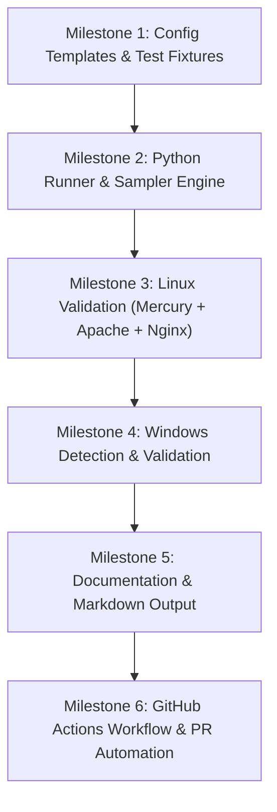

# Mercury Performance Benchmark Suite Workplan
## Mercury vs. Apache & Nginx

**Status:** Proposed / Draft  
**Target Version:** Mercury v0.38+ (refreshing legacy v0.22.0 baseline)  
**Primary Artifact:** `build_tools/benchmark.py` + dedicated config templates  

---

## 1. Overview & Objectives

Mercury's [README.md](file:///home/travis/Documents/Projects/Mercury/README.md#L45-L75) currently features a memory benchmark comparing Mercury to Apache, showing 58% lower idle memory and 11% lower load memory on Linux (and 46% / 38% on Windows). These metrics date back to commit `113e6b2` around **v0.22.0 / v0.23.0** (October 2025).

Since then, Mercury has evolved significantly:
- Persistent FastCGI gateway communicating directly with PHP-FPM / persistent `php-cgi`
- Streaming compression pipeline (Brotli, Zstandard, Gzip, Deflate)
- Bounded asynchronous logging queues and lock-free/low-contention optimizations
- Connection buffer reuse and dynamic thread pool expansion

### Goals
1. **Refresh the Stale Baseline**: Re-benchmark Mercury v0.38+ under modern workloads.
2. **Add Nginx to the Comparison**: Include Nginx alongside Apache for a comprehensive industry benchmark.
3. **Automate Benchmarking**: Provide a single, repeatable Python runner (`build_tools/benchmark.py`) that can execute one-off runs locally or run in automated testing environments.
4. **Zero New External Python Dependencies**: Rely strictly on Python's standard library and packages already required for Mercury's test suite (`psutil`, `brotli`, `zstandard`).
5. **Apples-to-Apples Configuration**: Standardize concurrency models, logging overhead, connection reuse, and document roots across all three servers.

---

## 2. Platform Strategy: Linux & Windows

### Linux (Primary Target)
- **Environments:** Ubuntu, Debian, Fedora, Arch, Rocky Linux.
- **Server Binaries:** `bin/mercury` vs. system `apache2` (`httpd`) vs. `nginx`.
- **Concurrency Architecture:**
  - **Mercury:** Worker thread pool (`ThreadPool` with configurable worker count).
  - **Apache:** `mpm_event` or `mpm_worker` (avoiding `mpm_prefork` which spawns heavy per-connection processes and unfairly distorts memory metrics).
  - **Nginx:** Event-driven worker processes (`epoll`).
- **Memory Instrumentation:** Continuous RSS sampling via `psutil.Process` including recursive child worker tracking.

### Windows (Secondary / Cross-Platform Target)
- **Market Share & Value:** Mercury natively supports Windows (`bin/mercury.exe` via MinGW-w64 and Winsock), and Windows performance is explicitly cited in `README.md`.
- **Feasibility:**
  - Python and `psutil` operate seamlessly across Windows and Linux without code divergence.
  - Apache on Windows uses Apache Lounge builds (`httpd.exe` with `mpm_winnt`, multithreaded IOCP).
  - Nginx distributes official Windows zip packages (`nginx.exe`, which operates on `select()`).
- **Strategy:** 
  - Design `build_tools/benchmark.py` to be platform-aware from day one.
  - Auto-detect the OS (`sys.platform`). On Windows, look for `httpd.exe` and `nginx.exe` in PATH or common paths (e.g., `C:\nginx`, `C:\Apache24`).
  - If third-party binaries are absent on Windows, allow partial execution (e.g., benchmarking Mercury standalone or skipping servers gracefully).

---

## 3. "Apples-to-Apples" Parity Rules

To ensure honest, reproducible, and peer-defensible numbers, all three servers must be configured to identical baseline constraints:

| Parameter | Mercury | Apache (`apache2`) | Nginx | Rationale |
|---|---|---|---|---|
| **Port Binding** | `8080` (HTTP) / `8081` (HTTPS) | `8082` | `8084` | Non-privileged ports (>1024), no root required |
| **Document Root** | Dedicated `tests/root/` fixture | Same `tests/root/` | Same `tests/root/` | Identical on-disk file layout & inode cache |
| **Worker Threads / Concurrency** | 10 worker threads | `mpm_event` with 10 threads (`ThreadsPerChild 10`) | 1 worker process (or matching core count) | Avoids skewing by over/under-provisioning thread pools |
| **Access Logging** | Disabled / `/dev/null` during throughput | Disabled / `/dev/null` | Disabled / `/dev/null` | Disk I/O bottlenecks mask networking/CPU efficiency |
| **Error Logging** | Isolated log file in `logs/` | Isolated log file in `logs/` | Isolated log file in `logs/` | Retain errors for troubleshooting without stdout pollution |
| **Keep-Alive** | Enabled (timeout 5s, max 10,000) | Enabled (`KeepAliveTimeout 5`, `MaxKeepAliveRequests 10000`) | Enabled (`keepalive_timeout 5s`, `keepalive_requests 10000`) | Standardizes HTTP/1.1 connection reuse behavior |
| **Compression** | Evaluated in dedicated compression trials | `mod_deflate` / `mod_brotli` (when tested) | `gzip` / `brotli` (when tested) | Keep compression disabled during raw static transfer tests |

---

## 4. Technical Architecture of `build_tools/benchmark.py`

### 4.1 Dependency Detection & Graceful Fallback
- Check for Mercury binary (`bin/mercury` on Linux, `bin/mercury.exe` on Windows).
- Check for Apache binary (`apache2`, `httpd`, `httpd.exe`).
- Check for Nginx binary (`nginx`, `nginx.exe`).
- Check for load generation tools:
  - Prefer `wrk` or `hey` if installed on the host for high-concurrency throughput testing.
  - Provide a **pure Python load generator** (using `threading`, `http.client`, or keep-alive sockets) as a built-in fallback requiring zero external tools.
- If Apache or Nginx is missing, display a clear notice (e.g., `[INFO] Apache not found; skipping Apache trials. Install via 'apt install apache2'`).

### 4.2 Lifecycle of a Single Trial
For each server under test:
```
┌────────────────┐
│  Build Config  │  Generate dedicated unprivileged config file
└───────┬────────┘
        ▼
┌────────────────┐
│  Start Server  │  Launch process via subprocess.Popen (unprivileged user)
└───────┬────────┘
        ▼
┌────────────────┐
│ Idle Baseline  │  Wait 2s for thread pools/workers to settle; record Idle RSS
└───────┬────────┘
        ▼
┌────────────────┐
│ Warmup Phase   │  Send 200–500 requests to warm file caches & buffers
└───────┬────────┘
        ▼
┌────────────────┐
│  Load Trial    │  Fire benchmark load (e.g. 50 concurrent connections, 10s)
│  & Sampling    │  Sample total RSS (parent + children) every 50ms via psutil
└───────┬────────┘
        ▼
┌────────────────┐
│ Server Cleanup │  SIGTERM / graceful shutdown; wait for exit; release ports
└───────┬────────┘
```

### 4.3 Workload Test Matrix
1. **Static Micro-payload (1 KiB HTML/Text)**: Tests connection handling, request parsing, and raw routing overhead.
2. **Static Medium Payload (64 KiB Image/Asset)**: Tests socket write buffering and kernel transfer performance.
3. **Static Large Payload (1 MiB File)**: Tests chunking, zero-copy/streaming efficiency, and memory stability.
4. **Dynamic PHP / FastCGI (Optional secondary test)**: Simple `phpinfo()` or `echo "Hello World"` script via PHP-FPM / FastCGI backend.

### 4.4 Metrics Collected & Computed
- **Idle Memory (RSS)**: Baseline Resident Set Size in MB before receiving load.
- **Avg. Load Memory (RSS)**: Mean RSS during the active load generation window.
- **Peak Load Memory (RSS / VmHWM)**: Maximum RSS observed during the trial.
- **Throughput**: Requests per second (RPS).
- **Latency**: Mean latency, p50, and p99 (tail latency).
- **Multi-Trial Averaging**: Run 5 distinct trials per configuration and average results (filtering outliers).

---

## 5. Configuration File Artifacts

Dedicated benchmark configuration files will be stored under `tests/conf_files/benchmark/`:

### 1. `tests/conf_files/benchmark/mercury.conf`
- Configured with high port (`8080`).
- DocumentRoot pointing to test fixtures.
- Access logging turned off or sent to ephemeral path.
- ThreadPool size fixed to match test core allocation.

### 2. `tests/conf_files/benchmark/apache.conf`
- Standalone Apache configuration runnable without root (`apache2 -d . -f ... -X` or single-process daemon).
- Uses `PidFile`, `LockFile`, `ErrorLog` in `logs/benchmark_apache/`.
- Enables `mpm_event` with fixed `ThreadsPerChild 10`.
- DocumentRoot pointing to identical test fixtures.

### 3. `tests/conf_files/benchmark/nginx.conf`
- Standalone Nginx configuration runnable without root (`nginx -p . -c ...`).
- Uses `pid logs/benchmark_nginx/nginx.pid;` and unprivileged directories.
- `worker_processes 1;` with matching connection limits.
- Access logging turned off (`access_log off;`).

---

## 6. GitHub Actions Automation (`.github/workflows/benchmark.yml`)

Running benchmarks in a dedicated GitHub Actions workflow provides several major benefits:
- Eliminates the need to configure, spin up, or maintain local Windows and secondary Linux environments.
- Uses pristine, isolated virtual machines (`ubuntu-24.04` and `windows-latest`) where Apache, Nginx, and Mercury can be installed and executed cleanly.
- Decouples performance testing from standard push/PR test pipelines to avoid burning CI minutes on everyday commits.

### 6.1 Workflow Trigger & Configuration (`workflow_dispatch`)
The workflow is triggered manually on-demand via `workflow_dispatch` with customizable inputs:

```yaml
name: Performance Benchmark

on:
  workflow_dispatch:
    inputs:
      release_tag:
        description: "Release tag to benchmark (e.g., 'latest' or 'v0.38.1')"
        required: false
        default: "latest"
        type: string
      trials:
        description: "Number of trials to average per server"
        required: false
        default: "5"
        type: string
      duration:
        description: "Duration of each load test in seconds"
        required: false
        default: "10"
        type: string
      create_pr:
        description: "Open a PR updating README.md with benchmark results"
        required: false
        default: false
        type: boolean
      servers:
        description: "Comma-separated servers to benchmark (mercury,apache,nginx)"
        required: false
        default: "mercury,apache,nginx"
        type: string
```

### 6.2 Release Binary Acquisition Strategy

Rather than spending CI time compiling Mercury from scratch on every run (which requires toolchains, static library builds, and MinGW-w64 on Windows), the workflow pulls pre-compiled, optimized release binaries directly from GitHub Releases:

- **Performance & Speed**: Saves 3–5 minutes of build and linking time per platform job.
- **Production Fidelity**: Tests the exact release-mode binary distributed to users, complete with `-O3` optimizations, symbols stripped, and UPX compression (matching real-world user deployments).
- **Automated Extraction via `gh release download`**:
  - **Linux (`ubuntu-24.04`)**:
    ```bash
    mkdir -p ./bin ./temp_release
    gh release download "${{ inputs.release_tag }}" --pattern "Linux_*.tar.gz" --dir ./temp_release
    tar -xzf ./temp_release/Linux_*.tar.gz --strip-components=2 -C ./bin "*/bin/mercury"
    chmod +x ./bin/mercury
    rm -rf ./temp_release
    ```
  - **Windows (`windows-latest`)**:
    ```powershell
    New-Item -ItemType Directory -Force -Path ./bin, ./temp_release
    gh release download "${{ inputs.release_tag }}" --pattern "Windows_*.zip" --dir ./temp_release
    Expand-Archive -Path ./temp_release/Windows_*.zip -DestinationPath ./temp_release/extracted -Force
    Copy-Item ./temp_release/extracted/*/bin/mercury.exe ./bin/mercury.exe
    Remove-Item -Recurse -Force ./temp_release
    ```
- *Fallback*: If `inputs.release_tag` is set to `"build"`, the workflow falls back to compiling from the current branch (`make linux` / MinGW).

### 6.3 CI Environment Execution Strategy

#### Linux Job (`ubuntu-24.04`)
- Fetch latest release binary via `gh release download` (as detailed above).
- Install Apache, Nginx, and wrk cleanly via `apt`:
  ```bash
  sudo apt-get update && sudo apt-get install -y apache2 nginx wrk
  ```
- Run `python3 build_tools/benchmark.py --trials ${{ inputs.trials }} --duration ${{ inputs.duration }} --output-format json,markdown`.
- Publish the Markdown table directly to `$GITHUB_STEP_SUMMARY` for instantaneous viewing in the GitHub Actions UI.
- Upload raw JSON metrics as a workflow artifact (`linux-benchmark-results`).

#### Windows Job (`windows-latest`)
- Fetch latest release binary `mercury.exe` via `gh release download`.
- Install Apache Lounge and Nginx automatically via Chocolatey (pre-installed on `windows-latest` runners):
  ```powershell
  choco install apache-httpd nginx -y
  ```
- Run `python build_tools/benchmark.py --trials ${{ inputs.trials }} --duration ${{ inputs.duration }} --output-format json,markdown`.
- Publish the Windows Markdown table directly to `$GITHUB_STEP_SUMMARY`.
- Upload raw JSON metrics as a workflow artifact (`windows-benchmark-results`).

### 6.4 Automated README Update PR Workflow
When `create_pr: true` is selected:
1. An aggregation job downloads both `linux-benchmark-results` and `windows-benchmark-results`.
2. A helper script injects the freshly generated Markdown tables into the Performance section of [`README.md`](file:///home/travis/Documents/Projects/Mercury/README.md).
3. **No Changes to `version.txt` or `CHANGELOG.md`**: The commit deliberately updates *only* [`README.md`](file:///home/travis/Documents/Projects/Mercury/README.md). This ensures that `.github/workflows/compare-changelog-version.yml` remains valid and green, and avoids premature version bumping.
4. Uses GitHub CLI (`gh pr create`) or `peter-evans/create-pull-request` to open a pull request:
   - **Branch:** `perf/benchmark-results-${{ github.sha }}`
   - **Title:** `perf: update performance benchmarks in README.md`
   - **Body:** Contains the full benchmark breakdown, system specifications, and trial averages for review and approval by the maintainer.

---

## 7. Implementation Milestones



### Milestone 1: Config Templates & Test Fixtures
- Create directory `tests/conf_files/benchmark/`.
- Author self-contained, unprivileged configuration files for Mercury, Apache, and Nginx.
- Establish standardized test payload fixtures (1 KiB, 64 KiB, 1 MiB) under `tests/root/benchmark/`.

### Milestone 2: Python Runner & Sampler Engine (`build_tools/benchmark.py`)
- Implement dependency discovery (`apache2`/`httpd`, `nginx`, `wrk`, `hey`).
- Implement background process supervisor with `psutil` sampling (recursive memory summation across all spawned child workers).
- Implement standard load generator (invoking `wrk` if available, falling back to built-in threaded Python client).
- Implement multi-trial aggregation and statistics computation.

### Milestone 3: Linux Validation
- Test execution on Linux across Mercury, Apache, and Nginx.
- Verify unprivileged startup and shutdown of Apache and Nginx without lingering zombie processes or port conflicts (`EADDRINUSE`).
- Compare memory and throughput consistency across 5 trials.

### Milestone 4: Windows Compatibility
- Validate runner on Windows with native `bin/mercury.exe`.
- Detect Windows distributions of Apache (`httpd.exe`) and Nginx (`nginx.exe`) when available.
- Ensure graceful degradation if Apache/Nginx are not installed on the Windows test machine.

### Milestone 5: Output Generation & Documentation
- Format results into a copy-pasteable Markdown table directly compatible with [`README.md`](file:///home/travis/Documents/Projects/Mercury/README.md).
- Provide CLI flags:
  - `--servers mercury,apache,nginx` (select subset)
  - `--trials 5` (number of runs to average)
  - `--duration 10` (seconds per load phase)
  - `--concurrency 50` (simultaneous connections)
  - `--output-format markdown|json`
- Update [`agents/TESTING.md`](file:///home/travis/Documents/Projects/Mercury/agents/TESTING.md) and [`agents/WORKFLOWS.md`](file:///home/travis/Documents/Projects/Mercury/agents/WORKFLOWS.md) with benchmark execution instructions.

### Milestone 6: GitHub Actions Workflow & PR Automation
- Author `.github/workflows/benchmark.yml` with `workflow_dispatch` trigger.
- Implement matrix execution on `ubuntu-24.04` and `windows-latest`.
- Add `$GITHUB_STEP_SUMMARY` reporting.
- Implement conditional PR creation step updating [`README.md`](file:///home/travis/Documents/Projects/Mercury/README.md) without altering `version.txt` or `CHANGELOG.md`.

---

## 8. Expected README Output Format

Upon execution, the runner produces an updated summary table ready for [`README.md`](file:///home/travis/Documents/Projects/Mercury/README.md):

```markdown
#### Linux (Ubuntu 24.04 x86_64)

| Metric | Mercury (v0.38.1) | Apache (2.4.58) | Nginx (1.24.0) | Comparison |
|---|---|---|---|:---:|
| **Avg. Idle Memory** | **TBD MB** | TBD MB | TBD MB | **Mercury is XX% lighter** |
| **Avg. Load Memory** | **TBD MB** | TBD MB | TBD MB | **Mercury is XX% lighter** |
| **Req / Second (1 KB)** | **TBD rps** | TBD rps | TBD rps | **Mercury is XX% faster** |
| **Avg. Latency (p99)** | **TBD ms** | TBD ms | TBD ms | **Mercury is XX% lower** |

#### Windows (x64)

| Metric | Mercury (v0.38.1) | Apache (2.4.58) | Nginx (1.24.0) | Comparison |
|---|---|---|---|:---:|
| **Avg. Idle Memory** | **TBD MB** | TBD MB | TBD MB | **Mercury is XX% lighter** |
| **Avg. Load Memory** | **TBD MB** | TBD MB | TBD MB | **Mercury is XX% lighter** |
| **Req / Second (1 KB)** | **TBD rps** | TBD rps | TBD rps | **Mercury is XX% faster** |
| **Avg. Latency (p99)** | **TBD ms** | TBD ms | TBD ms | **Mercury is XX% lower** |

*Baseline averages across 5 separate trials over loopback using tests/conf_files/benchmark.*
```

