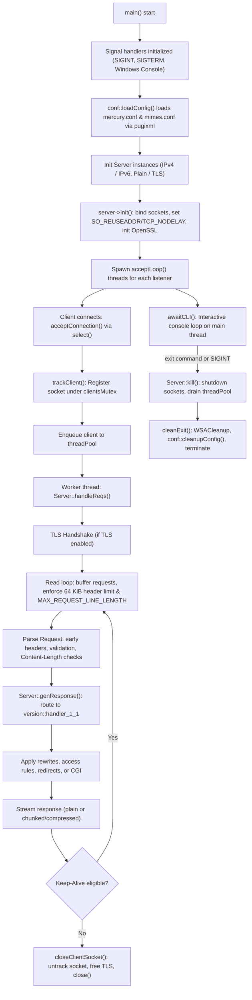

# Mercury Architecture & System Design

This document details the architectural design, subsystem organization, execution lifecycle, concurrency model, and protocol handling mechanisms of Mercury.

---

## 1. System Overview & Technology Stack

Mercury is an HTTP/1.1 (with backward-compatible HTTP/1.0 and HTTP/0.9 support) web server implemented in C++20. It is designed to be lightweight, cross-platform (Linux and Windows), highly concurrent, and secure by default.

### Core Stack
- **Language**: C++20 (`-std=c++20`), compiled with `-Wall -Wextra -Werror`.
- **Compilers**: GCC (`g++`) and Clang (`clang++`) on Linux; MinGW-w64 (`x86_64-w64-mingw32-g++`) for Windows cross-compilation.
- **Crypto & TLS**: OpenSSL 3.x / 4.x (TLS 1.3 support, certificate and key management).
- **Compression**: Brotli (`libbrotlienc`, `libbrotlicommon`), Zstandard (`libzstd`), and zlib (`libz`, supporting gzip and deflate).
- **Configuration Parsing**: PugiXML (`libs/pugixml`) for XML-based server configurations.
- **Dynamic Content**: Fast CGI execution engine supporting PHP via `php-cgi`.
- **Binary Packaging**: UPX executable compression for release builds.

---

## 2. Directory & Module Organization

The codebase is organized modularly under [`src/`](../src/):

```
src/
├── main.cpp                  # Process entry point, signal traps, CLI, server dispatch
├── winheader.hpp             # Windows platform abstraction & Winsock2 wrappers
├── conf/                     # Configuration and rule engine
│   ├── conf.hpp / conf.cpp   # Global settings, XML loader (pugixml), IP parsers
│   └── rules/                # Routing, access, and header rewrite rules
│       ├── match.hpp / match.cpp       # Pattern matcher, access rules, custom response headers
│       ├── access.hpp / access.cpp     # CIDR & IP allow/deny access control lists
│       ├── redirect.hpp / redirect.cpp # 301/302 URL redirection rules
│       ├── rewrite.hpp / rewrite.cpp   # URL rewriting engine
│       └── mod_headers.hpp / mod_headers.cpp # Request and response header manipulations
├── http/                     # Network protocol, connection engine, and codecs
│   ├── server.hpp / server.cpp     # IPv4 server socket, epoll/poll/select listener, worker dispatcher
│   ├── server-ipv6.hpp / server-ipv6.cpp # IPv6 server specialization
│   ├── tools.hpp / tools.cpp       # HTTP date formatters (RFC 7231), status phrases, MIME lookups
│   ├── message/              # HTTP request and response representations
│   │   ├── request.hpp / request.cpp   # Request parser, method/URI/header decoding, validation
│   │   └── response.hpp / response.cpp # Response serializer, chunked framing, status mapping
│   ├── tls/                  # TLS context management
│   │   └── tls.hpp / tls.cpp           # OpenSSL TLS context initialization and configuration
│   ├── telemetry/            # Server metrics and update checks
│   │   ├── stats.hpp / stats.cpp       # Traffic counters, status breakdown, active worker stats
│   │   └── version_checker.hpp / version_checker.cpp # Background startup check for updates
│   ├── streams/              # Transfer encoding and compression streams
│   │   ├── body_stream.hpp / body_stream.cpp # Chunked transfer encoding and body streaming
│   │   └── compressor_stream.hpp / compressor_stream.cpp # Compression streams (Brotli, Zstd, Gzip, Deflate)
│   ├── version/              # Protocol version handlers
│   │   ├── handler_0_9.hpp / handler_0_9.cpp # Simple HTTP/0.9 requests
│   │   ├── handler_1_0.hpp / handler_1_0.cpp # HTTP/1.0 legacy handler
│   │   └── handler_1_1.hpp / handler_1_1.cpp # Full HTTP/1.1 pipeline handler
│   ├── fastcgi/              # Persistent FastCGI gateway client
│   │   ├── protocol.hpp      # FastCGI record headers, constants, padding, byte-swapping
│   │   ├── params.hpp / params.cpp # Zero-allocation FCGI_PARAMS encoder/decoder
│   │   └── client.hpp / client.cpp # Cross-platform socket transport (UDS/TCP) & streaming
│   └── cgi/                  # CGI processing engine
│       └── process.hpp / process.cpp # Pipe creation, fork/exec or CreateProcess for php-cgi
├── io/                       # File system abstraction
│   ├── file.hpp / file.cpp   # File stat, metadata, and memory-buffered read access
│   └── file_tools.hpp / file_tools.cpp # Path normalization, directory indexing, traversal guards
├── logs/                     # Thread-safe logging subsystem
│   ├── logger.hpp / logger.cpp # Access and error log streams, IP masking / hashing
├── res/                      # Windows resource definitions (icon, manifest)
└── util/                     # Utilities and helpers
    ├── cli.hpp / cli.cpp     # Interactive server terminal commands (pwd, status, ping, phpinit)
    ├── thread_pool.hpp / thread_pool.cpp # Fixed-size worker pool with work queue
    ├── string_tools.hpp / string_tools.cpp # Case conversion, trimming, URL decoding, token splitting
    └── toolbox.hpp / toolbox.cpp # Memory usage inspection, system time, hex utilities
```

---

## 3. Server Lifecycle & Execution Flow



### Detailed Lifecycle Steps
1. **Startup & Signal Initialization**:
   - `initSigHandler()` configures `SIGINT` and `SIGTERM` on Linux (ignoring `SIGPIPE`), and `SetConsoleCtrlHandler` on Windows.
   - Sockets are non-blocking or managed via timeouts (`select` / `poll`).
2. **Configuration Loading**:
   - `conf::loadConfig()` parses `conf/mercury.conf` using `pugi::xml_document`. Defaults are substituted if optional nodes are omitted.
   - MIME types are loaded from `conf/mimes.conf` into an in-memory map `conf::MIMES`.
3. **Listener Instantiation**:
   - Up to four `http::Server` / `http::ServerV6` instances are created based on configuration:
     - IPv4 HTTP (default port 8080 or 80)
     - IPv6 HTTP
     - IPv4 HTTPS (TLS port, e.g., 8081 or 443)
     - IPv6 HTTPS
   - Each calls `init()`, configuring socket options (`SO_REUSEADDR`, `TCP_NODELAY`, Linux `SO_REUSEPORT`) and setting up OpenSSL contexts (`SSL_CTX`).
4. **Accept & Concurrency Model**:
   - Every active listener runs `acceptLoop()` in its own `std::thread`.
   - `acceptConnection()` uses `select()` with a 1-second timeout to check for incoming connections, permitting clean exit when `isExiting` is set.
   - Accepted sockets are registered via `trackClient()` under `clientsMutex` before dispatching to the `ThreadPool`.
5. **Connection Processing (`handleReqs`)**:
   - TLS handshake is performed per-connection if enabled (`SSL_accept`).
   - A dedicated loop reads data into a connection buffer up to `MAX_KEEP_ALIVE_REQUESTS`.
   - Incoming bytes are checked for the complete header block (`\r\n\r\n` or single `\r\n` for HTTP/0.9).
   - Once framed, the request is dispatched to `genResponse()`.
6. **Graceful Shutdown (`kill`)**:
   - `isExiting` atomic flag is set.
   - Listener sockets are shutdown and closed.
   - All active client sockets in `clientSocks` are shutdown with `SD_BOTH` / `SHUT_RDWR` to wake blocked reader threads without prematurely closing descriptors while workers are still active.
   - The thread pool drains remaining workers, and `SSL_CTX` is freed.

---

## 4. HTTP Protocol Engine & Handlers

### Framing & Boundary Protections
- **Header Size Limits**: Mercury strictly limits headers to 64 KiB (`maxHeaderBytes = 64 * 1024`). Requests exceeding this are rejected with **431 Request Header Fields Too Large**.
- **Request Line Limits**: Configurable via `conf::MAX_REQUEST_LINE_LENGTH` (default 8 KiB). Exceeded lengths return **414 URI Too Long**.
- **Framing Ambiguities**:
  - Duplicate `Content-Length`, negative values, or values that overflow return **400 Bad Request**.
  - `Transfer-Encoding` in incoming client requests is rejected with **400 Bad Request** to avoid request smuggling, while Mercury supports chunked encoding for responses.
  - Pipelined requests are safely preserved: extra bytes in the socket buffer beyond the declared `Content-Length` are retained for the next iteration.
- **HTTP/0.9 Detection**:
  - Simple requests (`GET /path\r\n` without version tokens or headers) are recognized and dispatched to `handler_0_9` or rejected with **505** if legacy versions are disabled.

### Version Dispatching (`genResponse`)
- **HTTP/1.1** (`version::handler_1_1::genResponse`):
  - Validates method (`GET`, `HEAD`, `OPTIONS`, `POST`, `PUT`, `PATCH`, `DELETE`).
  - Checks URI lengths and 400 parsing errors.
  - Applies rewrite rules from `conf::rewriteRules`.
  - Runs access control checks against `conf::matchConfigs`.
  - Checks redirect rules (`conf::redirectRules`).
  - Verifies document root containment to prevent directory traversal (`request.isInDocumentRoot()`).
  - Dispatches `.php` files to the CGI subsystem.
  - Handles `If-Modified-Since` caching with **304 Not Modified**.
  - Serves static files, directory indexes, or custom error pages.
  - Handles single and multiple HTTP Range requests (**206 Partial Content**).
- **HTTP/1.0** (`version::handler_1_0::genResponse`):
  - Legacy HTTP/1.0 support without persistent connections unless `Connection: keep-alive` is explicitly requested.
- **HTTP/0.9** (`version::handler_0_9::genResponse`):
  - Raw payload response without status lines or headers.

---

## 5. Compression Subsystem

Mercury implements a pluggable stream-based compression architecture via [`ICompressor`](../src/http/streams/compressor_stream.hpp):

- **Supported Encodings**:
  - `br`: Brotli encoder (`BrotliEncoderState`).
  - `zstd`: Zstandard compression stream (`ZSTD_CStream`).
  - `gzip`: zlib with `MAX_WBITS + 16`.
  - `deflate`: standard zlib stream.
- **Negotiation**:
  - Extracted from `Accept-Encoding` header based on client preference and server capability.
  - Compression is only applied if response payload exceeds `conf::MIN_COMPRESSION_SIZE` and MIME type is compressible (e.g., text, JSON, XML, HTML).
  - Clean streaming interfaces allow compression directly during socket writes without buffering entire large files in RAM.

---

## 6. CGI Architecture & FastCGI Gateway

Mercury provides dual execution strategies for dynamic PHP execution: persistent FastCGI (recommended for high throughput) and legacy CGI fork-and-exec.

### Persistent FastCGI Client (`src/http/fastcgi/`)
On Linux, `Backend` starts a private PHP-FPM pool for omitted/`auto` addresses
only, after Mercury drops sudo/doas privileges. It selects a versioned FPM
executable, spawns a foreground master in an owned process group, and waits for
its private Unix socket before accepting requests. The pool inherits Mercury's
runtime identity and uses a mode-0600 socket within a mode-0700 temporary
directory. Shutdown terminates/reaps the owned master and removes runtime files.
Explicit endpoints remain externally managed. Failed automatic startup stays
bound to the private endpoint, so it cannot silently use an unrelated system pool.

When `<EnableFastCGI> on </EnableFastCGI>` is set, requests for `.php` files are dispatched directly over network sockets to a persistent FastCGI daemon (such as PHP-FPM or `php-cgi -b`):

- **Binary Wire Protocol (`protocol.hpp`)**:
  - Implements the FastCGI specification v1.0, managing 8-byte aligned `FCGI_Header` records (`FCGI_BEGIN_REQUEST`, `FCGI_PARAMS`, `FCGI_STDIN`, `FCGI_STDOUT`, `FCGI_STDERR`, and `FCGI_END_REQUEST`).
  - Strict network byte order (`htons`/`ntohs`) and integer conversions for 16-bit and 32-bit fields.
- **Zero-Allocation Parameter Encoder (`params.hpp`)**:
  - Encodes RFC 3875 environment variables into standard FastCGI variable-length key-value tuples.
  - Automatically splits oversized parameter blocks across multiple 64 KiB records and pads payloads to 8-byte boundaries.
- **Cross-Platform Socket Transport (`client.hpp`)**:
  - **Linux**: Supports high-performance UNIX domain sockets (`AF_UNIX`) and TCP loopback sockets (`AF_INET`/`AF_INET6`).
  - **Windows**: Supports TCP loopback sockets with `TCP_NODELAY`.
- **Zero-Configuration Detection**:
  - When configured as `"auto"`, automatically scans `/run/php/` and `/run/php-fpm/` on Linux, sorting candidates by PHP semantic version tuple descending to connect to the latest installed PHP version (e.g. `php8.4-fpm.sock` > `php8.3-fpm.sock`).
- **Zero-Disk Streaming (`MemoryStream`)**:
  - Eliminates all temporary disk files in `tmp/`.
  - HTTP request bodies are streamed directly from client socket buffers into `FCGI_STDIN` records.
  - Demuxes FastCGI `FCGI_STDOUT` records directly into memory, parses CGI status/headers, and returns a `Response` backed by an in-memory stream.
- **Resilience & Timeouts**:
  - FastCGI socket connect, write, and response reading are bounded by `conf::FASTCGI_TIMEOUT` via `poll()` / `WSAPoll()`.
  - Stalls return **504 Gateway Timeout**; backend connection failures return **502 Bad Gateway**.

### Legacy Fork-and-Exec CGI (`src/http/cgi/process.cpp`)
If FastCGI is disabled but `<EnablePHPCGI> on </EnablePHPCGI>` is enabled:

- **Execution Model**:
  - On Linux: pipes are established for standard input and output (`pipe()`), followed by `fork()` and `execve()`.
  - On Windows: anonymous pipes with `SECURITY_ATTRIBUTES` and `CreateProcessA()` invoke `php-cgi.exe`.
- **Environment Compliance**:
  - Adheres to RFC 3875 (CGI/1.1), setting `GATEWAY_INTERFACE`, `REQUEST_METHOD`, `SCRIPT_FILENAME`, `SCRIPT_NAME`, `QUERY_STRING`, `CONTENT_LENGTH`, `CONTENT_TYPE`, `SERVER_SOFTWARE`, `REMOTE_ADDR`, and forwarded HTTP headers prefixed with `HTTP_`.
- **Binary Safety**:
  - Input bodies (e.g. file uploads, Unicode payloads) are piped directly into CGI stdin without UTF-8 re-encoding or text stripping.
  - CGI output headers and body are parsed dynamically, preserving binary payloads.

---

## 7. Security Architecture & Threat Mitigations

1. **Path Traversal Mitigation**:
   - All incoming paths are normalized via `std::filesystem::weakly_canonical` and sanitized to prevent directory traversal attacks (e.g., `../`, `%2e%2e/`, `//`, `\`).
   - `request.isInDocumentRoot()` asserts that resolved canonical paths remain strictly within `conf::DOCUMENT_ROOT`.
2. **Header Injection Prevention**:
   - Header values (such as in `Location` redirects or modified response headers) are stripped or rejected if they contain unescaped CRLF (`\r\n`) sequences.
3. **Privacy & DNT / Sec-GPC Handling**:
   - `conf::CLIENT_SECURITY_MODE` controls how client IP addresses are recorded in access logs:
     - `CLIENT_SEC_MINIMAL`: Plain IP recorded.
     - `CLIENT_SEC_GPC_MASKED`: Subnet-masked when DNT or Sec-GPC header is present.
     - `CLIENT_SEC_GPC_HASHED`: Salted SHA-256 hash when DNT/Sec-GPC is present.
     - `CLIENT_SEC_MASKED`: Masked for all clients.
     - `CLIENT_SEC_HASHED`: Salted SHA-256 hash for all clients.
4. **Denial of Service (DoS) Bounds**:
   - Hard limits on request lines (8 KiB), headers (64 KiB), request bodies (`MAX_REQUEST_BODY`), and worker thread pool queues prevent unbounded memory allocation.

